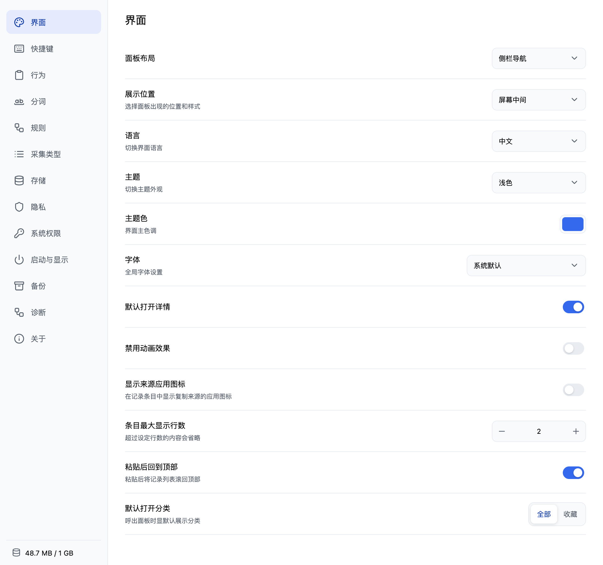

# Project Introduction

[English](README.md) · [简体中文](README.zh-CN.md)

<p align="center"></p>

A local clipboard history app. The clipboard is used constantly in everyday work, so CPaste lets you go beyond the basics: use word segmentation or the rule engine to further edit clipboard content and process or output it instantly.

Fully local with no network access, except for downloading dictionaries and updates.

[Download installer](https://github.com/Chikomago/CPaste/releases/latest)

## Interface preview

Three layouts to choose from.

### Sidebar navigation


### Horizontal browsing


### Column browsing


### Settings



## Features

- Basics: Save text, rich text, images, and file records, with search, sorting, editing, pinning, and favorites.
- Side panel: Bring up the panel with a shortcut; supports centered or cursor-following placement.
- Settings: Plain-text and file-path pasting, source app blocklist, sensitive content masking, and backup/restore.
- Segmentation: Supports **UTF-8 encoded `.txt` and `.dict` text files**, with one word per line or jieba format.
- Rules: QuickJS is embedded in the Rust layer to run scripts; you can also write your own JavaScript to implement custom rules.

## Development

The segmentation engine uses [jieba-rs](https://github.com/messense/jieba-rs).

Requires Node.js 20+, pnpm, Rust 1.90+, and the [Tauri prerequisites for your platform](https://v2.tauri.app/start/prerequisites/).

```sh
pnpm install
pnpm tauri dev
```

Build an installer with `pnpm tauri build`. The first build downloads Rust dependencies.

See [Code structure](docs/architecture.md) for the directory layout and module responsibilities.

## Permissions

On macOS, pasting directly for the first time may require allowing CPaste to control the keyboard in **System Settings → Privacy & Security → Accessibility**.

## License

[GPL-3.0-only](LICENSE)
